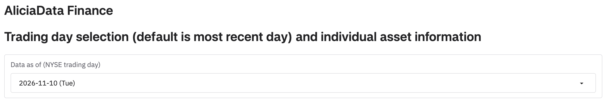
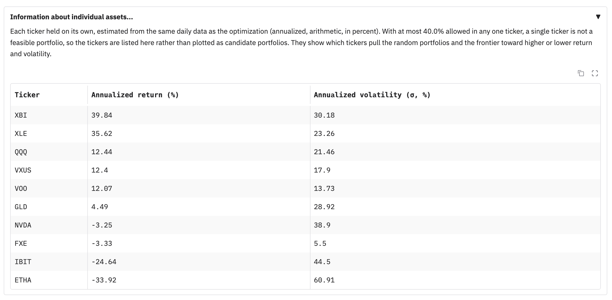
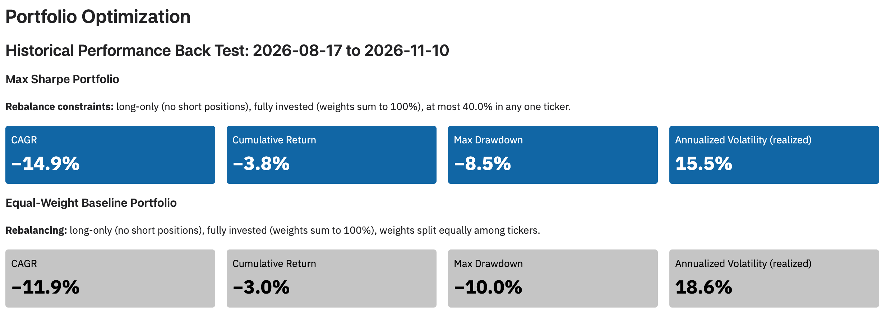
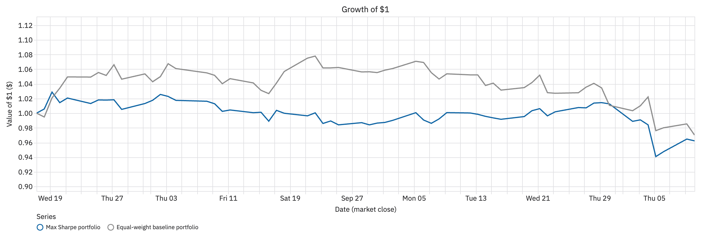
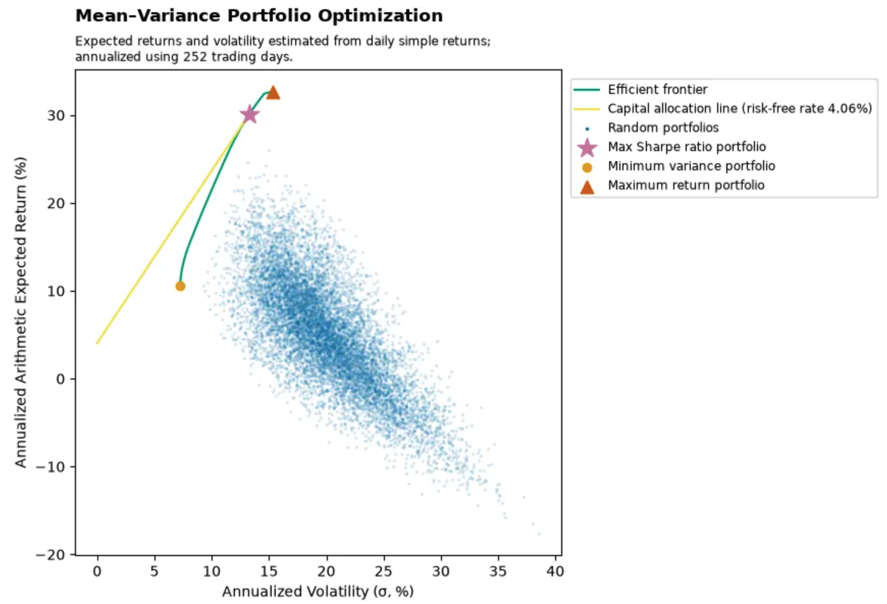
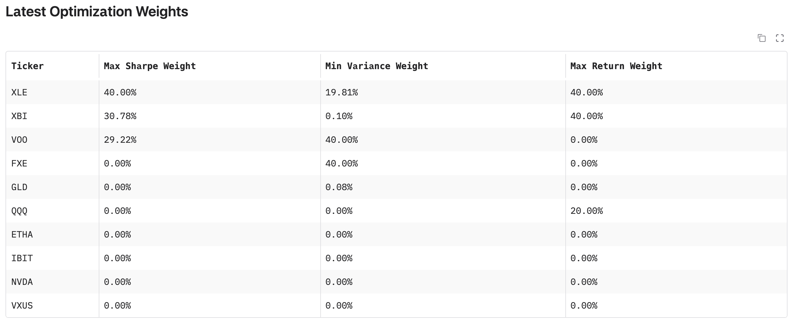
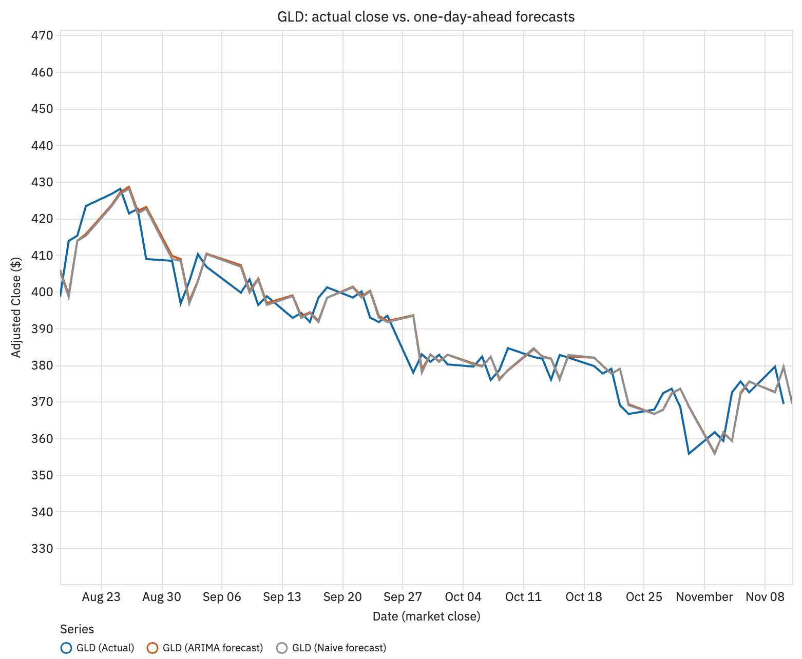
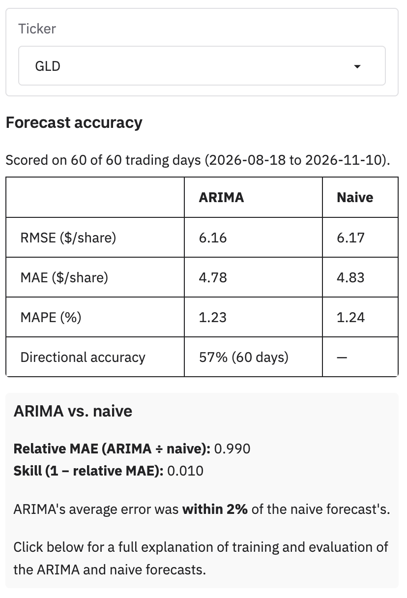

# Dashboard Guide

This guide explains how to read **AliciaData Finance**, the dashboard at [https://aliciadata.com](https://aliciadata.com). It walks through the page from top to bottom: what each control selects, what each plot and table shows, and which direction is better for each metric.

The dashboard only displays results. A separate backend computes every optimization, back test, forecast, and metric, and publishes the results by date; the dashboard downloads and displays them.

This guide deliberately stays brief on methods. For how the results are computed, how the metrics are defined, why the methods were chosen, and their limitations and future directions, see the **[Methods and Results](https://akey7.github.io/posts/aliciadata-finance/)** document.

## Other documentation

- **[README](../README.md):** a short overview of the project, with links to the live dashboard and the backend repository.
- **[Architecture and Installation](ARCHITECTURE_AND_INSTALLATION.md):** how the app is built, configured, tested, and deployed, for engineers who want to run or change it.
- **[Interface Contract](INTERFACE_CONTRACT.md):** the exact files, fields, and units the backend publishes and the dashboard reads.
- **[Methods and Results](https://akey7.github.io/posts/aliciadata-finance/)** (external): the full discussion of methods, metrics, results, and limitations.

## Layout of the page

The dashboard is a single page, read from top to bottom:

1. **AliciaData Finance:** the date selector and the information about individual assets.
2. **Portfolio Optimization:**
   - **Historical Performance Back Test:** how an optimized portfolio did over recent trading days, compared with an equal-weight baseline.
   - **Latest Optimization:** the optimized portfolios estimated from the most recent data.
3. **Timeseries Analysis:** one-day-ahead price forecasts for one ticker, compared with a naive baseline forecast.

Both sections answer the same kind of question: **does the model do better than a simple baseline?** In Portfolio Optimization the baseline is a portfolio that holds every ticker in equal amounts. In Timeseries Analysis it is a forecast that tomorrow's close equals today's.

## Selecting a date

The **Data as of (NYSE trading day)** dropdown selects which backend run the whole page shows. Each entry is the last trading day of price data in that run, shown with its weekday, such as `2026-11-06 (Fri)`. The newest date is selected when the page opens, and older dates stay available for comparison.

Changing the date reloads **both** sections from that date's results, so everything on the page always comes from the same run. The backend is run by hand, so dates are not consecutive and the newest date may be a few days old. Check this dropdown to see how current the data is.

Older dates were produced by earlier versions of the backend, so some of them lack newer parts of the page, such as the back test or the accuracy metrics. In those places, the page shows a short message instead.

### Information about individual assets

This collapsed accordion lists every ticker in the selected run, each held on its own, with its **annualized return (%)** (higher is better) and **annualized volatility (σ, %)** (lower is better). Click a column header to sort by it. The table helps explain where the portfolios in the Latest Optimization plot sit.

### Why you cannot choose your own tickers

Neither the date dropdown nor the ticker dropdown (see "Timeseries Analysis") lets you type in a ticker of your own. **This is a deliberate design choice.** The set of tickers is configured separately in the backend, which computes every result from that fixed set ahead of time. Because each run's inputs are fixed and recorded, the results shown for any date can be reproduced exactly. The dashboard only displays them; it does not compute new ones on request.

## Portfolio Optimization

This section compares an optimized portfolio, the **maximum Sharpe ratio portfolio** (labeled "Max Sharpe"), with a naive **equal-weight baseline** that simply holds every ticker in equal amounts. For how the two are constructed and compared, see the [Methods and Results](https://akey7.github.io/posts/aliciadata-finance/) document.

### Historical Performance Back Test

The heading shows the period the back test covers. Over that period, the max Sharpe portfolio was periodically re-optimized using only the data available at each point in time, and the baseline was periodically reset to equal weights. The results are out of sample: each portfolio is scored on days that came after the data it was built from.

Each portfolio has a row of cards. The blue cards are the max Sharpe portfolio, and the gray cards are the equal-weight baseline:

| Card | Better when |
| --- | --- |
| **CAGR** | Higher |
| **Cumulative Return** | Higher |
| **Max Drawdown** | Closer to 0% |
| **Annualized Volatility (realized)** | Lower |

The note below the cards states how many daily returns the metrics were calculated from. The volatility card appears only for dates whose results include it.

The **Growth of $1** plot shows what $1 invested in each portfolio at the start of the period was worth at each later market close. The blue line is the max Sharpe portfolio and the gray line is the equal-weight baseline, so the plot compares the optimized portfolio against the naive baseline day by day. A line that ends higher grew more over the period. Hover over the plot to see the trading day and each portfolio's value.

### Latest Optimization

This part shows the portfolios estimated from the price history ending on the selected date. The line under the heading gives the dates of that price history.

The **Mean–Variance Portfolio Optimization** plot places portfolios by their annualized volatility (horizontal axis, lower is better) and annualized expected return (vertical axis, higher is better), so portfolios further **up and to the left** are better:

- **Random portfolios** (the cloud of points): portfolios drawn at random under the same rules as the optimizer. They are centered on the equal-weight portfolio, so the cloud shows roughly where the naive baseline and portfolios like it sit.
- **Efficient frontier** (the curve): the highest expected return available at each level of volatility.
- **Max Sharpe ratio portfolio:** the portfolio with the best return for its volatility, after subtracting the risk-free rate.
- **Minimum variance portfolio:** the portfolio with the lowest volatility.
- **Maximum return portfolio**, shown for dates whose results include it: the portfolio with the highest expected return.
- **Capital allocation line:** the line from the risk-free rate (given in the legend) to the max Sharpe ratio portfolio. A steeper line means more return per unit of volatility.

Comparing the marked portfolios with the cloud shows how far the optimized portfolios are from portfolios like the naive baseline.

The **Latest Optimization Weights** table gives each ticker's share of each portfolio, in percent: **Max Sharpe Weight**, **Min Variance Weight**, and, when available, **Max Return Weight**. Each portfolio's weights add up to 100%. A weight of 0.00% means the portfolio does not hold that ticker.

The collapsed **Portfolio optimization, random sampling, and back testing assumptions...** accordion lists the settings behind this section's results. For the methods themselves, see the [Methods and Results](https://akey7.github.io/posts/aliciadata-finance/) document.

## Timeseries Analysis

This section compares one-day-ahead **ARIMA** price forecasts with a **naive forecast**, which predicts that each day's close equals the most recent close before it. ARIMA adds value only when its errors are smaller than the naive forecast's. For how both forecasts are made and compared, see the [Methods and Results](https://akey7.github.io/posts/aliciadata-finance/) document.

### Choosing a ticker

The **Ticker** dropdown selects which ticker the plot and the accuracy metrics show. It lists only the tickers in the selected date's results. As explained in "Why you cannot choose your own tickers", other tickers cannot be entered.

### Forecast plot

The plot shows, for each trading day, three lines:

- **Actual:** the ticker's adjusted closing price.
- **ARIMA forecast:** the model's forecast of that close, made using only data from before that day.
- **Naive forecast:** the most recent observed close before that day.

Where the forecast lines stay closer to the actual line, the forecasts were more accurate. Every day except the last has an actual close, so those forecasts can be checked. The **last point** is the forecast for the next trading day, which has not happened yet, so it has no actual close.

Hover over an ARIMA point to see the model behind that day's forecast. The model is refit every day, so its settings can change from one day to the next.

### Forecast accuracy

The **Forecast accuracy** table scores the ARIMA and naive forecasts on the same recent trading days, side by side. The line above it gives the number of days and their dates.

| Metric | Units | Better when |
| --- | --- | --- |
| **RMSE** | Dollars per share | Lower |
| **MAE** | Dollars per share | Lower |
| **MAPE** | Percent | Lower |
| **Directional accuracy** (ARIMA only) | Percent of days | Higher |

RMSE and MAE are in each ticker's own price units, so use them to compare ARIMA with the naive forecast for one ticker, not to compare tickers. MAPE is in percent, so it can be compared across tickers. The naive forecast predicts no change, so it has no directional accuracy.

The gray **ARIMA vs. naive** panel sums up the comparison in two numbers and a sentence:

| Metric | Better when |
| --- | --- |
| **Relative MAE** | Below 1 (ARIMA's errors were smaller than the naive forecast's) |
| **Skill** | Above 0 (ARIMA beat the naive forecast) |

Both are scale-free, so they can also be compared across tickers.

The collapsed **Reading the accuracy metrics, walk-forward ARIMA, naive forecasting, and out-of-sample evaluation...** accordion below the plot gives the training and scoring windows for the selected date. For how the metrics are calculated, see the [Methods and Results](https://akey7.github.io/posts/aliciadata-finance/) document.

---

**Not investment advice.** Every value shown is a backtest or model output computed from historical prices, and none of it predicts future results or recommends any investment.
